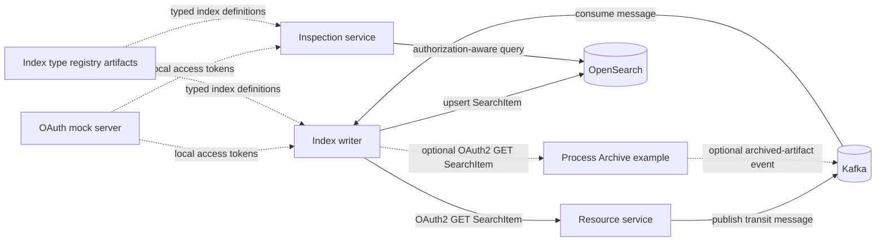

# JME OpenSearch Example

This project demonstrates event-driven indexing and authorization-aware searches using the jEAP OpenSearch components.
It is self-contained for local development and provides portable application artifacts for deployment-specific wrappers.

The example covers two indexing flows:

1. The included resource service creates transit data and publishes a Kafka message. The index writer consumes the
   message, retrieves the corresponding SearchItem over HTTP and writes it to OpenSearch.
2. An optional integration consumes archived-artifact events from the
   [JME Process Archive example](https://github.com/jme-admin-ch/jme-process-archive-example) and indexes decrees and
   decree documents. The application code is portable; the external topic, endpoint and OAuth configuration is supplied
   by the deployment environment.

## Modules

| Module | Purpose | Local port |
| --- | --- | ---: |
| `jme-opensearch-auth-scs` | Local OAuth2 mock server | 8180 |
| `jme-opensearch-resource-service` | Creates transit data, publishes messages and provides SearchItems | 8581 |
| `jme-opensearch-index-writer-service` | Consumes messages, retrieves SearchItems and writes them to OpenSearch; with maintenance enabled also stores upsert and delete jobs submitted as YAML | 8580 |
| `jme-opensearch-inspection-service` | Provides type-safe, authorization-aware OpenSearch queries | 8582 |
| `jme-opensearch-test` | Runs the portable transit flows, the maintenance job API and the maintenance target policy checks end-to-end against local infrastructure, confirming the default non-rollover index lifecycle | - |

## Architecture



The index writer's `opensearch/messages.json` maps each message and topic to an index type, reference provider, optional
condition and remote SearchItems endpoint. Index types and mappings are generated by the
[JME index type registry](https://github.com/jme-admin-ch/jme-index-type-registry).

The transit-document flow demonstrates each generated field shape:

| Mapping field                         | OpenSearch shape                            | Generated Java component |
|:--------------------------------------|:--------------------------------------------|:-------------------------|
| `goods_description`                   | Scalar                                      | `String`                 |
| `keywords`                            | Scalar collection                           | `List<String>`           |
| `customs_checks`                      | Nested collection                           | `List<CustomsChecks>`    |
| `customs_checks.office`               | Nested scalar                               | `String`                 |
| `customs_checks.tags`                 | Nested scalar collection                    | `List<String>`           |
| `customs_checks.details`              | Single nested object                        | `Details`                |
| `customs_checks.details.codes`        | Scalar collection in a single nested object | `List<String>`           |

The source mapping is defined in the index type registry at
[`index-types/jme/jmetransitdocument/JmeTransitDocument_mapping_v1_3.json`](https://github.com/jme-admin-ch/jme-index-type-registry/blob/main/index-types/jme/jmetransitdocument/JmeTransitDocument_mapping_v1_3.json).
The generated Java object is the
`ch/admin/bit/jme/opensearch/index/jme/transitdocument/JmeTransitDocumentDataV1.java` entry in the
`jme-transit-document-v1-1.3-sources.jar` artifact. Download the sources with
`./mvnw dependency:get -Dartifact=ch.admin.bit.jeap.jme.indextype.jme:jme-transit-document-v1:1.3:jar:sources`.
The generated source is then available in
`~/.m2/repository/ch/admin/bit/jeap/jme/indextype/jme/jme-transit-document-v1/1.3/jme-transit-document-v1-1.3-sources.jar`.

The end-to-end test verifies that these values survive resource serialization, indexing, typed search-result
deserialization and field-specific OpenSearch queries.

The transit-decision V3 flow demonstrates native OpenSearch analysis settings supplied by an index type. Its custom
analyzer maps `&` to `and`, splits text on whitespace and hyphens, lowercases and folds accents, and removes `and` as a
stopword. Consequently, the remark `Café & Müller-AG` is indexed as the tokens `cafe`, `muller`, `ag`. A custom
normalizer makes the keyword `Peter Müller` searchable as `peter muller`. OpenSearch still returns the original accented
values from `_source`.

These settings are defined in the index type registry's
[`JmeTransitDecision_mapping_v3_0.json`](https://github.com/jme-admin-ch/jme-index-type-registry/blob/main/index-types/jme/jmetransitdecision/JmeTransitDecision_mapping_v3_0.json).
Analysis changes require a new index-type major version because existing documents must be reindexed with the new
analysis chain.

## Prerequisites

- Java Development Kit 25
- Docker with Docker Compose
- `curl` and `jq` for the command-line walkthrough

Use the included Maven wrapper for all Maven commands.

## Build And Test

```bash
./mvnw clean verify
```

The build runs unit tests and license checks as well as two levels of integration testing:

- The inspection-service integration test starts that application with a real OpenSearch Testcontainer, indexes a
  document directly and queries it through the authorization-aware REST API.
- The `jme-opensearch-test` module starts the Compose infrastructure and all four applications. It creates transit
  documents and decisions through the resource API, waits for Kafka processing and verifies the resulting documents
  through the OAuth-protected inspection API. It submits and retrieves upsert and delete jobs through the YAML API,
  checks their OpenAPI entries, starts a second index writer instance to show that stored jobs are reused and one with
  maintenance disabled (see [Maintenance Jobs](#maintenance-jobs)). It also verifies that the job API refuses a delete
  job whose target has a rolling ISM policy applied (see
  [Maintenance Target Policy Check](#maintenance-target-policy-check)); this waits for ISM to apply the demo policy
  on its next job run, which adds up to a few minutes.

Run only the complete local end-to-end test with:

```bash
./mvnw verify -pl jme-opensearch-test
```

Docker must be available and ports 8180, 8580-8582, 9200, 12000 and 13000 must be free. The test starts and stops its
applications and Compose project automatically.

## Local Development

### Infrastructure

Start Kafka in KRaft mode, Schema Registry, OpenSearch and OpenSearch Dashboards:

```bash
docker compose --file docker/docker-compose.yml up --detach --wait
```

### Applications

Run the applications in separate terminals, in the order shown:

```bash
./mvnw -pl jme-opensearch-auth-scs spring-boot:run -Dspring-boot.run.profiles=local
./mvnw -pl jme-opensearch-resource-service spring-boot:run -Dspring-boot.run.profiles=local
./mvnw -pl jme-opensearch-index-writer-service spring-boot:run -Dspring-boot.run.profiles=local
./mvnw -pl jme-opensearch-inspection-service spring-boot:run -Dspring-boot.run.profiles=local
```

Local endpoints:

| Component | URL |
| --- | --- |
| Index writer Swagger UI (maintenance job API) | `http://localhost:8580/jme-opensearch-index-writer-service/swagger-ui/index.html` |
| Resource service Swagger UI | `http://localhost:8581/jme-opensearch-resource-service/swagger-ui/index.html` |
| Inspection service Swagger UI | `http://localhost:8582/jme-opensearch-inspection-service/swagger-ui/index.html` |
| OpenSearch API | `http://localhost:9200` |
| OpenSearch Dashboards | `http://localhost:5601` |

### Try The Example

Create a V3 transit decision with analyzed example values:

```bash
DECISION=$(curl --fail --silent --request POST \
  http://localhost:8581/jme-opensearch-resource-service/api/v3/transitdescisions)
jq . <<< "$DECISION"
```

Obtain an access token from the local OAuth mock:

```bash
TOKEN=$(curl --fail --silent --request POST \
  http://localhost:8180/jme-opensearch-auth-scs/oauth2/token \
  --header 'Content-Type: application/x-www-form-urlencoded' \
  --data-urlencode 'grant_type=client_credentials' \
  --data-urlencode 'client_id=inspection-internal-sys' \
  --data-urlencode 'client_secret=secret' | jq --raw-output '.access_token')
```

Create a transit document and extract one value of each field shape:

```bash
DOCUMENT=$(curl --fail --silent --request POST \
  http://localhost:8581/jme-opensearch-resource-service/api/transitdocuments)
GOODS_PREFIX=$(jq --raw-output '.searchItem.data.goods_description | split(" ")[0]' <<< "$DOCUMENT")
KEYWORD=$(jq --raw-output '.searchItem.data.keywords[0]' <<< "$DOCUMENT")
CUSTOMS_OFFICE=$(jq --raw-output '.searchItem.data.customs_checks[0].office' <<< "$DOCUMENT")
CUSTOMS_TAG=$(jq --raw-output '.searchItem.data.customs_checks[0].tags[0]' <<< "$DOCUMENT")
CUSTOMS_CODE=$(jq --raw-output '.searchItem.data.customs_checks[0].details.codes[0]' <<< "$DOCUMENT")
jq . <<< "$DOCUMENT"
```

After the Kafka message has been processed, search by the scalar, collection and nested values:

```bash
curl --fail --silent --get \
  http://localhost:8582/jme-opensearch-inspection-service/api/transitdocuments \
  --data-urlencode "goodsDescription=$GOODS_PREFIX" \
  --header "Authorization: Bearer $TOKEN" | jq .

curl --fail --silent --get \
  http://localhost:8582/jme-opensearch-inspection-service/api/transitdocuments/by-keyword \
  --data-urlencode "keyword=$KEYWORD" \
  --header "Authorization: Bearer $TOKEN" | jq .

curl --fail --silent --get \
  http://localhost:8582/jme-opensearch-inspection-service/api/transitdocuments/by-customs-office \
  --data-urlencode "office=$CUSTOMS_OFFICE" \
  --header "Authorization: Bearer $TOKEN" | jq .

curl --fail --silent --get \
  http://localhost:8582/jme-opensearch-inspection-service/api/transitdocuments/by-customs-tag \
  --data-urlencode "tag=$CUSTOMS_TAG" \
  --header "Authorization: Bearer $TOKEN" | jq .

curl --fail --silent --get \
  http://localhost:8582/jme-opensearch-inspection-service/api/transitdocuments/by-customs-code \
  --data-urlencode "code=$CUSTOMS_CODE" \
  --header "Authorization: Bearer $TOKEN" | jq .
```

After the Kafka message has been processed, search for the indexed decision:

```bash
curl --fail --silent --get \
  http://localhost:8582/jme-opensearch-inspection-service/api/transitdecisions \
  --data-urlencode 'decidedBy=peter muller' \
  --header "Authorization: Bearer $TOKEN" | jq .

curl --fail --silent --get \
  http://localhost:8582/jme-opensearch-inspection-service/api/transitdecisions/by-remarks \
  --data-urlencode 'remarks=cafe muller' \
  --header "Authorization: Bearer $TOKEN" | jq .
```

Request the current data of the decision in a fixed schema major, as a maintenance job does. This uses the index
writer's OAuth client, which holds the `searchitem:read` role:

```bash
READ_TOKEN=$(curl --fail --silent --request POST \
  http://localhost:8180/jme-opensearch-auth-scs/oauth2/token \
  --header 'Content-Type: application/x-www-form-urlencoded' \
  --data-urlencode 'grant_type=client_credentials' \
  --data-urlencode 'client_id=index-writer-read-client' \
  --data-urlencode 'client_secret=secret' | jq --raw-output '.access_token')
DECISION_ID=$(jq --raw-output '.searchItem.origin.id' <<< "$DECISION")

for MAJOR in 1 2 4; do
  curl --silent --include --get \
    http://localhost:8581/jme-opensearch-resource-service/index-api/searchitems \
    --data-urlencode 'index_type=JmeTransitDecision' \
    --data-urlencode "origin_id=$DECISION_ID" \
    --data-urlencode "index_major_version=$MAJOR" \
    --header "Authorization: Bearer $READ_TOKEN"
  echo
done
```

The same current decision is returned for majors 1 and 2. The payload shape follows the major (`transit_decision_id` in
major 1, `transit_decision_identifier` in major 2), and the `index-major-version` / `index-minor-version` headers state
what the provider produced. `origin.version` (`1.0.0`) is the business revision of the decision and is the same in
both answers. The schema major is neither that version nor a physical index name: the writer derives the target index
(`jme_transit_decision_v1_write`) from the index type. Major 4 does not exist, so the provider answers
`422 UNSUPPORTED_INDEX_MAJOR_VERSION` instead of returning another major.

Inspect the created indices:

```bash
curl --fail --silent 'http://localhost:9200/_cat/indices?v'
```

### Index Lifecycle

This example's business indices (`jme_transit_document_v*`, `jme_transit_decision_v*`,
`jme_decree_document_v*`) have **no ISM (Index State Management) policy attached by default** — this
is the normal setup, not something to configure away. Each is created once as `<name>-000001` and
written, updated and deleted from indefinitely through its write alias; the `-000001` suffix only
supports a *future* rollover and does not itself enable one. Normal indexing, updating, deleting and
searching all work this way, including after restarting the stack.

Verify the applied policy of a real business index with ISM Explain:

```bash
curl --fail --silent 'http://localhost:9200/_plugins/_ism/explain/jme_transit_decision_v1-000001?show_policy=true' | jq .
```

A missing `policy_id` confirms no policy is attached. Compare this with the
`jme_policy_check_rolling-000001` demo index below, which has a rollover policy deliberately attached
to demonstrate the opposite case.

Without rollover, there is no automatic age-based deletion and the single index keeps growing — plan
`number-of-shards` in `jme-opensearch-index-writer-service/src/main/resources/application-local.yml`
for the expected volume, and decide deliberately how (or whether) your domain retires old documents,
rather than relying on index age. Rollover remains available as a separate, deliberate opt-in: attach
an ISM policy via `ism_template` matching the index pattern, exactly as demonstrated for the
throwaway demo index in the [Maintenance Target Policy Check](#maintenance-target-policy-check)
section below. The maintenance job/task indices (`jeap_indexwriter_jobs`, `jeap_indexwriter_tasks`,
see [Maintenance Jobs](#maintenance-jobs)) must stay outside any such policy if maintenance is
enabled: their retention is handled by the service's own housekeeping, not by OpenSearch deleting the
index.

### Maintenance Jobs

An operator submits an upsert or delete job as YAML and reads the YAML report. This version only **stores** jobs: the
tasks stay open because execution is added in later stories. The local profile enables the feature with
`jeap.opensearch.indexwriter.maintenance.enabled=true`; the default is `false`, and then the service has no job
endpoints, no OpenAPI entries, no job indices and no housekeeping, while normal indexing works as before. See the
[library documentation](https://github.com/jeap-admin-ch/jeap-opensearch-index-writer-service/blob/main/docs/maintenance-jobs.md).

The OAuth mock provides two clients for the job API:

| Client | Roles |
| --- | --- |
| `job-operator-sys` | `upsertjob#create`, `deletejob#create`, `jobreport#read` |
| `job-reader-sys` | `jobreport#read` only (creating a job answers `403`) |

```bash
JOB_TOKEN=$(curl --fail --silent --request POST \
  http://localhost:8180/jme-opensearch-auth-scs/oauth2/token \
  --header 'Content-Type: application/x-www-form-urlencoded' \
  --data-urlencode 'grant_type=client_credentials' \
  --data-urlencode 'client_id=job-operator-sys' \
  --data-urlencode 'client_secret=secret' | jq --raw-output '.access_token')
WRITER=http://localhost:8580/jme-opensearch-index-writer-service
```

Submit an upsert job with an explicit schema major. The version `"3"` of the first reference is business metadata that
is only stored and reported. It never selects a schema, a provider request or a rollback:

```bash
JOB_ID=$(uuidgen)
curl --fail --silent --request PUT "$WRITER/api/upsert-jobs/$JOB_ID" \
  --header "Authorization: Bearer $JOB_TOKEN" --header 'Content-Type: application/yaml' --data-binary @- <<'YAML'
message:
  messageName: JmeTransitDecisionCreatedEvent
  topicName: jme-transit-decision-created
operation:
  indexType: JmeTransitDecision
  indexOperation: UPSERT
  indexMajorVersion: 2
originReferences:
- id: 'ref-1'
  version: '3'
- id: 'ref-2'
YAML
```

The report names the one fixed target (`selection: explicit`, `index-major-version: 2`,
`physical-index: jme_transit_decision_v2-000001`) and keeps `version: "3"`. Read it again, also after a restart:

```bash
curl --fail --silent "$WRITER/api/upsert-jobs/$JOB_ID" \
  --header "Authorization: Bearer $JOB_TOKEN" --header 'Accept: application/yaml'
```

Omit `indexMajorVersion` to select the highest configured major (3 for `JmeTransitDecision`; `selection: highest`).
Delete jobs select a major the same way and have IDs only:

```bash
curl --fail --silent --request PUT "$WRITER/api/delete-jobs/$(uuidgen)" \
  --header "Authorization: Bearer $JOB_TOKEN" --header 'Content-Type: application/yaml' --data-binary @- <<'YAML'
indexType: JmeTransitDecision
indexMajorVersion: 1
originReferences:
- id: 'ref-1'
- id: 'ref-2'
YAML
```

| Request | Answer |
| --- | --- |
| Same job ID, equivalent content | `200`, the retained job (submitter and timestamps do not matter) |
| Same job ID, changed `indexMajorVersion` or stored reference `version` | `409` |
| Unknown major, duplicate IDs (even with different versions), `version` or `allowRollback` on a delete job, too many references | `400`, nothing stored |
| Content type other than `application/yaml` / `application/x-yaml` | `415` |
| Rollover policy or multi-index layout on the target | `422 NOT_ALLOWED` |
| No token (GET / PUT) / missing role / unknown job / storage unavailable | `401` / `403` / `403` / `404` / `503` |

A `PUT` without token is answered with `403`, not `401`: the jEAP security chain checks CSRF before authentication, and
only requests that carry a bearer token are exempt from it.

With maintenance enabled the service creates the missing job and task indices (`jeap_indexwriter_jobs`,
`jeap_indexwriter_tasks`) on startup and reuses compatible existing ones, so jobs survive a restart. Open the
Swagger UI of the index writer (see the endpoint table) to see both operations with their YAML examples, all
responses and the required role.

Stop the running index writer, then start it with maintenance disabled to see the default behaviour. The job endpoints
answer `404`, the OpenAPI document lists no job paths, and the stored jobs stay untouched in OpenSearch:

```bash
./mvnw -pl jme-opensearch-index-writer-service spring-boot:run -Dspring-boot.run.profiles=local \
  -Dspring-boot.run.arguments=--jeap.opensearch.indexwriter.maintenance.enabled=false
curl --silent --output /dev/null --write-out '%{http_code}\n' "$WRITER/api/upsert-jobs/$JOB_ID" \
  --header "Authorization: Bearer $JOB_TOKEN"
curl --silent "http://localhost:9200/jeap_indexwriter_jobs/_count"
```

### Maintenance Target Policy Check

A maintenance job writes to one fixed physical target index, so the index writer refuses a target that is managed by a
rolling ISM policy. When a job is created, `JobTargetAcceptanceCheck` reads the policy applied to the target **once**
with ISM Explain. It looks for a `rollover` action in every state of the policy, including states the index has not
reached yet. The job API of the [previous section](#maintenance-jobs) calls this check when a job is submitted and answers
`422 NOT_ALLOWED` for a refused target; `OpenSearchExampleIT` verifies this refusal end-to-end through the job API
against a live index with a rolling policy attached. The full outcome matrix below (no policy, non-rolling policy,
undetermined policy, invalid/missing/non-concrete targets) is already covered by `IsmAppliedPolicyInspectorIT` in
[jeap-opensearch-index-writer-service](https://github.com/jeap-admin-ch/jeap-opensearch-index-writer-service); the
calls below show what the check reads so you can reproduce each outcome manually against this example's OpenSearch.

The target must be the physical index (for example `jme_transit_decision_v1-000001`), not the write or read alias.
An alias, a missing index and an invalid name are not policy results: the check throws
`JobTargetNotConcreteException`, `JobTargetNotFoundException` or `JobTargetNameInvalidException`.

Attach a policy whose rollover action is in a later state to a demo index:

```bash
curl --fail --silent --request PUT http://localhost:9200/jme_policy_check_rolling-000001 \
  --header 'Content-Type: application/json' --data '{"settings":{"number_of_replicas":0}}'
curl --fail --silent --request PUT http://localhost:9200/_plugins/_ism/policies/jme-policy-check-rollover \
  --header 'Content-Type: application/json' --data '{"policy":{"description":"demo","default_state":"hot","states":[
    {"name":"hot","actions":[],"transitions":[{"state_name":"warm","conditions":{"min_index_age":"3650d"}}]},
    {"name":"warm","actions":[{"rollover":{"min_doc_count":100000000}}],"transitions":[]}]}}'
curl --fail --silent --request POST http://localhost:9200/_plugins/_ism/add/jme_policy_check_rolling-000001 \
  --header 'Content-Type: application/json' --data '{"policy_id":"jme-policy-check-rollover"}'
```

The policy is attached immediately and Explain reports its `policy_id` right away. ISM applies the policy definition
on its next job run (Compose sets the job interval to one minute, the default is five minutes). Until then the check
cannot see the rollover action: it reports no policy or `POLICY_UNDETERMINED`, and both are allowed. Read the applied policy as the check
does:

```bash
curl --fail --silent \
  'http://localhost:9200/_plugins/_ism/explain/jme_policy_check_rolling-000001?show_policy=true' \
  | jq '.["jme_policy_check_rolling-000001"] | {policy_id, rollover_states: [.policy.states[]? | select(any(.actions[]; has("rollover"))) | .name]}'
```

| Applied policy | Check result |
| --- | --- |
| Rollover action in any state | Refused, `not-allowed` with target and reason; HTTP 422 `NOT_ALLOWED` from the job API |
| No rollover action | Allowed |
| No policy attached | Allowed |
| Policy metadata cannot be read (for example while `.opendistro-ism-config` is closed) | Allowed, without claiming that the target is non-rolling |

Remove the demo index and policy:

```bash
curl --silent --request DELETE http://localhost:9200/jme_policy_check_rolling-000001
curl --silent --request DELETE http://localhost:9200/_plugins/_ism/policies/jme-policy-check-rollover
```

Stop the infrastructure when finished:

```bash
docker compose --file docker/docker-compose.yml down
```

#### Permissions on a secured cluster

This example runs OpenSearch **without the security plugin** (`DISABLE_SECURITY_PLUGIN=true` in
`docker/docker-compose.yml`) and its tests use an unauthenticated client, so it does **not** verify the permissions
below. On a secured cluster the writer's role needs, for the policy check:

- cluster permission `cluster:admin/opendistro/ism/managedindex/explain`
- index permission `indices:admin/get` on the target index patterns

Without the explain permission every target is allowed as `policy_undetermined`, and rolling targets are not refused;
alert on that outcome. See [OpenSearch permissions](https://github.com/jeap-admin-ch/jeap-opensearch-index-writer-service/blob/main/docs/opensearch-permissions.md)
for the full permission set of the index writer. The library verifies the check against a security-enabled cluster
with this role in its own integration tests.

## API Reference

All paths below are relative to the service context path shown in the local endpoint table.

### Resource Service

| Method and path | Behavior |
| --- | --- |
| `POST /api/transitdocuments` | Creates a V1 transit document, stores its SearchItem and publishes `JmeCreateTransitDocumentCommand`; returns HTTP 201. |
| `POST /api/transitdescisions` | Creates a V1 transit decision, stores its SearchItem and publishes `JmeTransitDecisionCreatedEvent`; returns HTTP 201. |
| `POST /api/v2/transitdescisions` | Creates a V2 transit decision and publishes the same event type; returns HTTP 201. |
| `GET /index-api/searchitems` | SearchItem provider endpoint (role `searchitem:read`). Without `index_major_version` it returns the stored item as before. With `index_major_version=1`, `2` or `3` it builds the current transit decision for that schema major; other majors answer `422`. See [SearchItem endpoint](https://github.com/jeap-admin-ch/jeap-opensearch-searchitem-api/blob/master/docs/endpoint.md). |

The misspelled `transitdescisions` path is retained for compatibility with the original example.

### Inspection Service

| Method and path | Behavior |
| --- | --- |
| `GET /api/transitdocuments?goodsDescription=...` | Returns a page of authorized V1 transit documents whose `data.goods_description` contains a token with the given prefix. |
| `GET /api/transitdocuments/by-keyword?keyword=...` | Uses a term query on the scalar collection `data.keywords`. |
| `GET /api/transitdocuments/by-customs-office?office=...` | Uses a nested term query on the scalar `data.customs_checks.office`. |
| `GET /api/transitdocuments/by-customs-tag?tag=...` | Uses a nested term query on the scalar collection `data.customs_checks.tags`. |
| `GET /api/transitdocuments/by-customs-code?code=...` | Uses a nested term query through the single `details` object to `data.customs_checks.details.codes`. |
| `GET /api/transitdecisions?decidedBy=...` | Returns a page of authorized V1 or V2 transit decisions whose `data.decided_by` value starts with the given prefix. |
| `GET /api/decrees?originId=...` | Returns the first authorized decree whose `origin.id` starts with the given value, or HTTP 404. |
| `GET /api/decreedocuments?originId=...` | Returns the first authorized decree document whose `origin.id` starts with the given value, or HTTP 404. |

#### Paging and sorting

The transit-document and transit-decision searches take a Spring Data `Pageable`, so a caller can add `page`, `size`
and `sort` to any of them, for example `?goodsDescription=F&page=1&size=50&sort=data.goods_description,asc`. Sort
properties are OpenSearch field names, and the field has to be mapped as sortable in the index type. Paging uses
`from`/`size` and is therefore bounded by the index's `index.max_result_window` (10'000 by default).

Without a `sort` parameter the searches return the 20 most recently created matches, i.e. `origin.created` descending.
An explicit order matters: the result is capped at a page size, and without a sort OpenSearch returns an arbitrary
slice of the matches, so a freshly indexed item can stay invisible for good once more documents match than fit on a
page.

All inspection parameters are mandatory; omitting one returns HTTP 400. Prefix queries are case-insensitive.
`data.decided_by` is mapped as a `keyword`, so the prefix applies to the complete field value. `data.goods_description`
is mapped as `text`, so the prefix can match any analyzed token. For example, `goodsDescription=F` can match both
`Food products` and `Furniture`.

Queries below `data.customs_checks` use an OpenSearch nested query with `data.customs_checks` as the path. The
`details` field is a single object inside that nested document, so its `codes` field remains within the same nested query.

Inspection queries use `SearchItemClient.searchMultiVersionWithUserAuth`. A valid access token is required, and results
are filtered according to the caller's roles and the authorization rules in the index type descriptors. The local
`inspection-internal-sys` client has the `jme_read` role used by the walkthrough.

## Process Archive Integration

The optional Process Archive flow remains part of this portable codebase but is not enabled by the standalone local
configuration. See [Process Archive integration](./docs/PROCESS-ARCHIVE-INTEGRATION.md) for its event flow, classes,
configuration contract and ownership boundary.

## Related Projects

- [jEAP OpenSearch index writer](https://github.com/jeap-admin-ch/jeap-opensearch-index-writer-service)
- [jEAP OpenSearch client starter](https://github.com/jeap-admin-ch/jeap-opensearch-client-starter)
- [JME index type registry](https://github.com/jme-admin-ch/jme-index-type-registry)
- [JME Process Archive example](https://github.com/jme-admin-ch/jme-process-archive-example)
- [JME open source projects](https://github.com/jme-admin-ch/jme)

## Changes

This project is versioned using [Semantic Versioning](https://semver.org/), and all changes are documented in
[CHANGELOG.md](./CHANGELOG.md) following the format defined by [Keep a Changelog](https://keepachangelog.com/).

## License

This repository is Open Source Software licensed under the [Apache License 2.0](./LICENSE).
